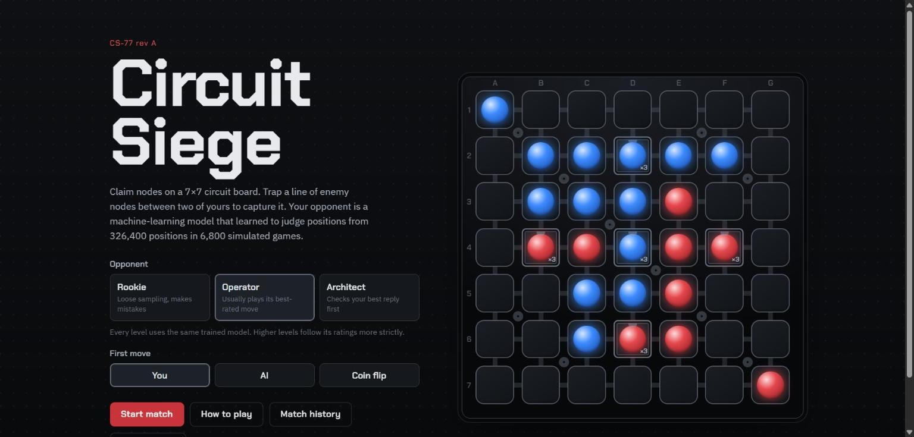
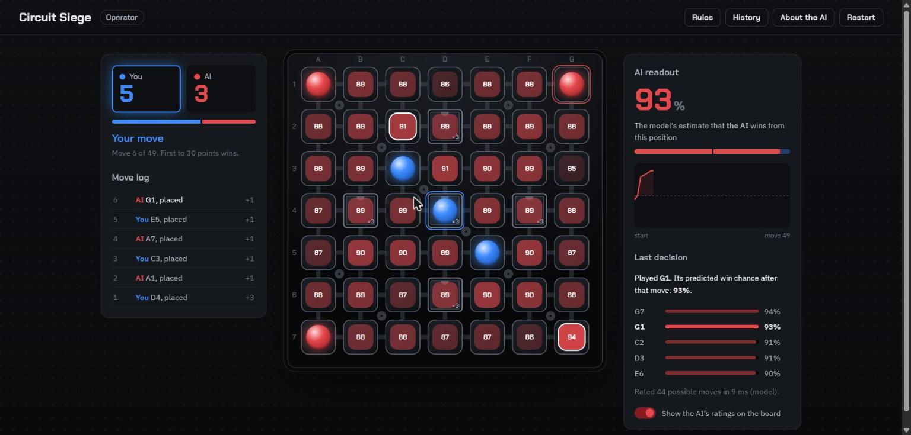

# Circuit Siege

A board game where you play against a machine learning model.

The board is a 7x7 grid styled like a circuit board. You and the computer take turns
placing pieces, and you capture the other side's pieces by trapping them between two of
yours. The computer opponent isn't a list of if/else rules. It uses a classifier I trained
on positions from 8,000 simulated games, which estimates how likely a position is to
end in a win. Every turn it tries each possible move, asks the model how good the
resulting board is, and picks from the best ones.





*In the second screenshot, "Show the AI's ratings" is switched on. Every empty cell shows
the win chance the model gave that move on its last turn.*

## Running it

You need Python 3.10 or newer. I used 3.14 on Windows.

```bash
python -m venv .venv
.venv\Scripts\activate          # on Mac/Linux: source .venv/bin/activate
pip install -r requirements-dev.txt

python run_game.py              # opens http://127.0.0.1:5000
```

`requirements.txt` only has what the game server needs (Flask, scikit-learn, NumPy,
joblib). `requirements-dev.txt` adds pandas, matplotlib and pytest for training,
evaluation and tests.

The dataset, the trained model and the evaluation reports are already in the repo, so
the game works straight away. To rebuild everything from scratch:

```bash
python scripts/generate_dataset.py   # simulate 8,000 games -> 384,000 positions (~1 min)
python scripts/train_model.py        # train and compare 8 models, keep the best (~5 min)
python scripts/evaluate_model.py     # test-set metrics, charts, AI vs bots (~12 min)
python -m pytest                     # 91 tests
```

All of it is seeded, so running these again gives the same dataset and the same splits.

## Rules

- You are **blue**, the AI is **red**. You can place on any empty cell.
- **Capturing:** if your new piece and another of your pieces trap a straight line of
  enemy pieces between them, the whole line becomes yours. This works in all 8
  directions, and one move can capture in several directions at once.
- The five cells drawn as chips (in a plus shape around the centre) are **cores** and
  are worth 3 points. Every other cell is worth 1.
- The game ends when all 49 cells are filled. There are 59 points in total, so the first
  player to 30 wins and a draw can't happen.

Corners can never be captured, and edges are hard to capture. A big capture often
leaves you open to an even bigger one on the next move.

### Difficulty levels

All three levels use the same trained model. The only difference is how strictly the AI
follows the model's ratings.

- **Rookie:** picks randomly, but better-rated moves are more likely. It makes plenty of
  mistakes, so it's beatable.
- **Operator:** picks from the model's top 3 moves, almost always the best one.
- **Architect:** takes the model's top 6 moves and, for each one, checks your best reply
  (again using the model). It plays the move that holds up best.

## How the AI works

```
 training (done once)                                    playing (every AI turn)
 --------------------                                    -----------------------
 scripted bots play 8,000 games                          for each legal move:
      -> every position saved with 68 features              simulate the move
      -> labelled "did this player win?"                    compute the same 68 features
      -> 4 model types compared, best one saved   ---->     model predicts P(AI wins)
           models/value_model.joblib                     choose a move from those predictions
```

The game rules only list which moves are legal. The choice between them comes from the
model. The same function (`src/circuit_siege/ai/features.py`) turns a board into
features both when building the training data and during a game, so the model always
sees exactly what it was trained on. There's a test that checks this.

The AI only sees the board and whose turn it is, which is the same information you
have. If the model file is missing, the game says so and tells you how to train it,
instead of quietly falling back to some other opponent.

## The dataset

There's no existing dataset for a game I made up, so I generated one. Four simple bots
play each other in random pairings:

- **random**
- **greedy:** grabs the most points right now
- **cautious:** looks at the opponent's best reply before moving
- **positional:** likes corners and edges

Each bot also has a small random chance of making a random move, so the games aren't
repetitive. The bots only exist to create realistic positions. They are not the AI you
play against.

- 8,000 games, seed 42. Raw games are in `data/raw/selfplay_games.jsonl`.
- Every position except the last one in each game becomes a row. That's 384,000 rows,
  stored in `data/processed/positions.csv.gz`. `positions_sample.csv` has the first
  2,000 rows if you just want to look.
- Label: 1 if the player whose point of view the row is from went on to win, else 0.
  The labels are a 50/50 split.
- Features:
  - the 49 cells (+1 mine, -1 theirs, 0 empty)
  - points and cores held
  - corners and edges held
  - pieces next to empty cells
  - how many points each side could capture next move
  - turn and move-parity features

  The full list is in `features.py`.
- There are no missing values. About 30k rows repeat, mostly early-game positions that
  lots of games pass through. I kept them, because they really are that common.
- **The train/validation/test split is done by game** (5,600 / 1,200 / 1,200). If I
  split by row, positions from the same game would end up in both train and test, which
  would make the test results look better than they really are.

More detail: `reports/data_report.md`.

## Results

### Choosing the model

Every model was trained on the training games and compared on the validation games. I
chose by log-loss rather than accuracy, because the AI ranks moves by the predicted
probabilities, so those need to be good, not just the yes/no answer.

| model | val log-loss | val accuracy | val AUC |
|---|---|---|---|
| **Histogram gradient boosting** | **0.445** | 0.768 | 0.868 |
| Random forest | 0.456 | 0.764 | 0.863 |
| Logistic regression | 0.470 | 0.757 | 0.853 |
| Neural network (MLP) | 0.675 | 0.735 | 0.822 |

Gradient boosting won. It scores all the moves for one turn in about 5 ms. The neural
network was interesting: its accuracy wasn't terrible, but its probabilities were far
too confident, and that's exactly what log-loss punishes. Full table:
`reports/model_selection.md`.

### Predicting the winner on 1,200 unseen games

| | accuracy | AUC | log-loss |
|---|---|---|---|
| **My model** | **76.6%** | **0.863** | **0.452** |
| "Whoever has more points wins" | 63.4% | 0.706 | - |
| Always guess the same class | 49.8% | 0.500 | 0.693 |

The model beats just counting points in every stage of the game. The difference is
biggest in the opening, at 70% vs 48%, because the score changes so much early on that
it barely means anything.

The part I liked most is the permutation importance chart. By far the most important
features are **corners held by each side**. I never told the model that corners can't
be captured; it worked that out from the data.

### AI vs the bots

| | win rate | games |
|---|---|---|
| Rookie vs greedy bot | 55% | 100 |
| Rookie vs positional bot (strongest bot) | 7% | 100 |
| Operator vs all four bots | 95-100% | 100 each |
| Architect vs all four bots | 92-100% | 60 each |
| Architect vs Operator | 85% | 60 |

Rookie is meant to lose sometimes. Architect beating Operator 85% of the time shows the
extra lookahead step actually helps. Confidence intervals, average margins and all the
charts (confusion matrix, ROC, calibration, feature importance) are in
`reports/evaluation_report.md` and `reports/figures/`.

## Learning from your games (optional)

The AI does not learn while you play. What it does instead:

1. When you run the game on your own computer, every finished game is saved to
   `data/player_games/matches.jsonl`. (The online version can't write files, so it
   only keeps your results in your browser.)
2. When you want to, run `python scripts/retrain_with_player_data.py` (after at least 5
   games). It trains a new candidate model on the original data plus your games, then
   compares it with the current model on the test games and in 40 games head-to-head.
3. The new model only replaces the old one if it isn't worse. The old model is copied to
   `models/archive/` first, so you can always switch back. `--dry-run` runs the checks
   without replacing anything.

## Deploying to Vercel

The repo is ready to deploy as is:

1. Go to [vercel.com/new](https://vercel.com/new) and import this GitHub repo.
2. Leave the settings on their defaults and click **Deploy**.

Vercel finds `app.py` in the root, which creates the Flask app, and installs
`requirements.txt`. `.vercelignore` keeps the dataset, reports and tests out of the
deployment, so only the game and the trained model get uploaded.

To make this work on serverless hosting, the server doesn't keep any games in memory.
The browser sends the list of moves played so far with every request, and the server
replays them, which also checks that each one is legal. Then it applies the new move.
A whole game is only 49 moves, so this is fast. Match history is stored in the
browser.

The server signs the match record (HMAC), so a browser can't send back an edited
history. Locally the key is random each time the server starts. On Vercel, you can
optionally add an environment variable `CIRCUIT_SIEGE_SECRET` (any long random
string) under Project Settings → Environment Variables. That turns signing on for the
hosted version too. Without it the hosted game still works, but someone editing their
own requests could only cheat in their own game, since the online version doesn't
save matches anywhere.

## Project layout

```
run_game.py                 start the game locally
app.py                      entry point for Vercel / other WSGI hosts
scripts/                    generate data, train, evaluate, retrain
src/circuit_siege/
    game/                   the rules (no ML in here)
    ai/                     features, the AI player, model loading, the data bots
    training/               dataset building, model selection, retraining
    evaluation/             metrics, baselines, AI-vs-bot matches
    web/                    Flask server + the HTML/CSS/JS front end
data/                       generated dataset
models/                     trained model + model card
reports/                    data, training and evaluation reports, charts
tests/                      pytest tests
docs/                       design notes and screenshots
```

**Built with:** Python, scikit-learn, pandas, NumPy, matplotlib, Flask, and plain
HTML/CSS/JavaScript (no frameworks). I went with a browser front end instead of Pygame
because it was easier to make it look good and work on different screen sizes.
Everything runs locally and doesn't need any API keys.

## Tests

`python -m pytest` runs 91 tests. They cover:

- the capture rules in every direction, illegal moves, scoring and game end
- features matching between training and play, and the data checks
- the split being by game
- training, saving and loading the model, and missing or broken model files
- the AI always choosing a legal move
- the web API (full games, bad input, playing out of turn, edited or forged move history,
  requests landing on different server instances)
- the retraining checks

## Limitations

- The training games are between bots, so the model knows what wins *between bots like
  these*. A good human might find weaknesses the bots never tested. Retraining with real
  games is the way to fix that.
- The AI only looks one or two moves ahead.
- A lot of early positions could still go either way, so 100% accuracy isn't possible.
  76.6% should be compared with the 63.4% baseline, not with 100%.
- The retraining feature works, but I haven't collected enough real games yet to measure
  whether it helps.

## Author

Devansh Vats
