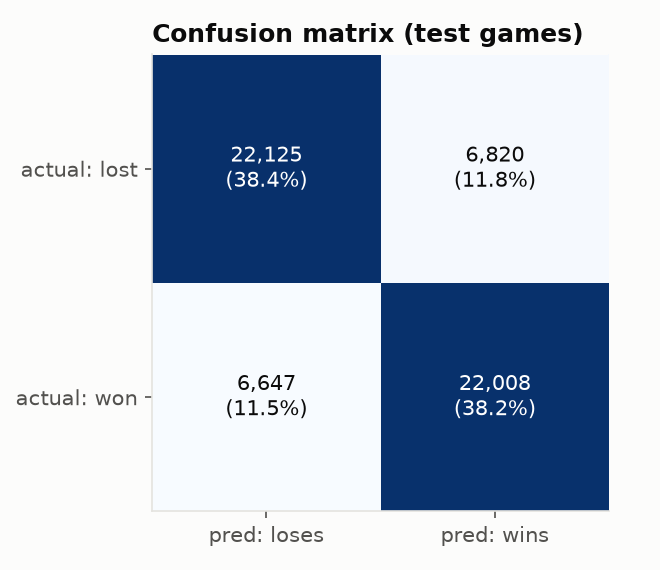
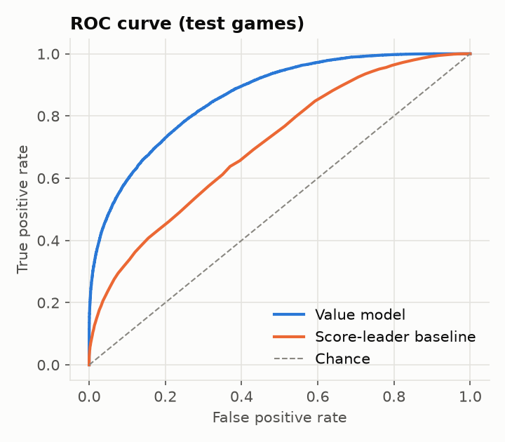
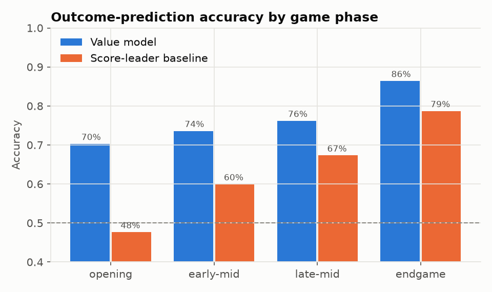
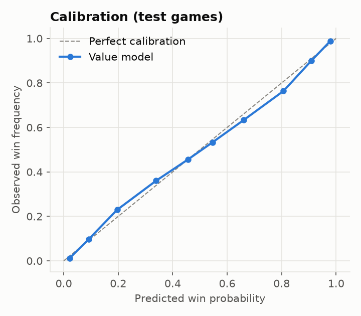
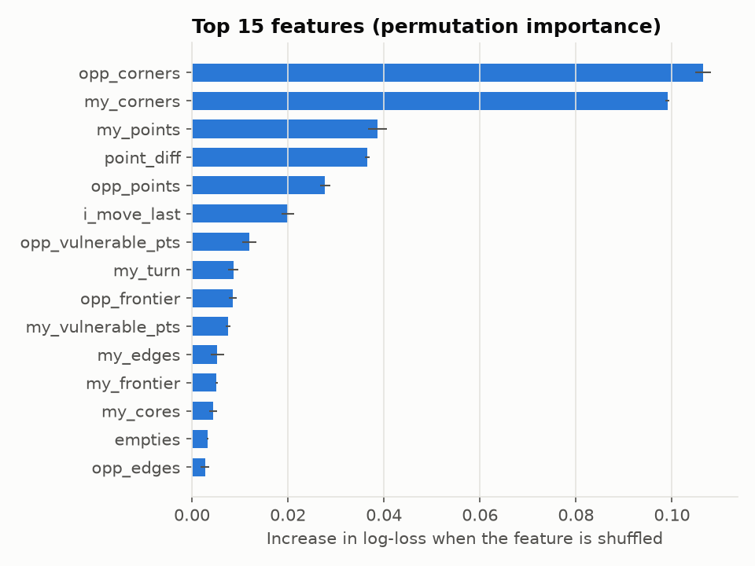
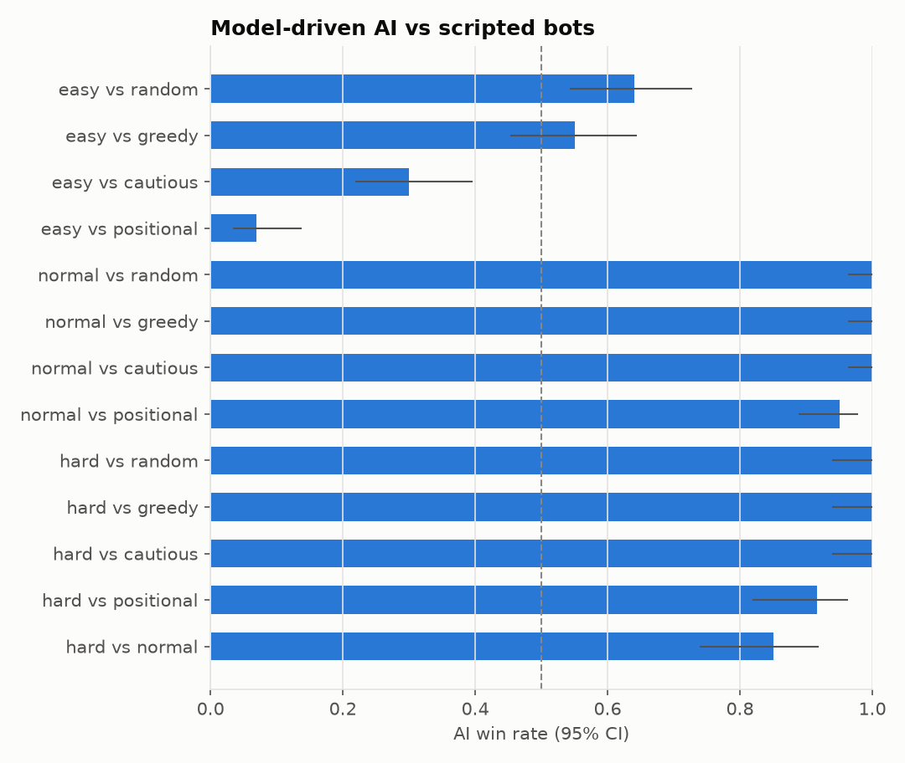

# Evaluation Report

Model: `hist_gradient_boosting` `{"learning_rate": 0.05, "max_leaf_nodes": 63, "max_iter": 400, "l2_regularization": 1.0}`, version `v20261014-082937`.
Generated by `scripts/evaluate_model.py`. All numbers come from real runs.

## 1. Outcome prediction on held-out games

The test set has 57,600 positions from **1,200 games** that were never used
for training or model selection. The split is by game, so no position from a test game was seen.

| predictor | accuracy | precision | recall | F1 | ROC-AUC | log-loss | Brier |
|---|---|---|---|---|---|---|---|
| **Value model** | 0.7662 | 0.7634 | 0.7680 | 0.7657 | 0.8627 | 0.4524 | 0.1515 |
| Baseline: score leader wins | 0.6340 | 0.6306 | 0.6380 | 0.6343 | 0.7064 | n/a | n/a |
| Baseline: majority class | 0.4975 | 0.4975 | 1.0000 | 0.6644 | 0.5000 | 0.6931 | 0.2500 |

**How to read this**

- *Accuracy* is the share of positions where the model correctly predicts the eventual winner
  (threshold 0.5). Many positions are genuinely undecided, especially in the opening, so
  100% is impossible. The useful question is how far the model beats the baselines.
- *Log-loss* and *Brier* measure the quality of the **probabilities**. Lower is better,
  and 0.693 is the log-loss of a coin flip. The AI ranks moves by these probabilities,
  so this is the metric that matters most for play.
- *ROC-AUC* is the chance that a randomly picked winning position gets a higher score than
  a randomly picked losing one.

Confusion matrix (rows = actual lost/won, cols = predicted lose/win): `[[22125, 6820], [6647, 22008]]`

 

### Accuracy by game phase

| phase | positions | value model | score-leader baseline |
|---|---|---|---|
| opening (ply 1-12) | 14,400 | 0.703 | 0.476 |
| early-mid (13-24) | 14,400 | 0.736 | 0.599 |
| late-mid (25-36) | 14,400 | 0.762 | 0.673 |
| endgame (37-48) | 14,400 | 0.864 | 0.787 |

The outcome becomes more predictable as the board fills up. The model's advantage over
simply counting points is largest in the **opening (ply 1-12)** (70.3% vs 47.6%), where the current score is a poor
guide because nodes keep flipping.

 

### What the model relies on (permutation importance)

| feature | mean increase in log-loss when shuffled |
|---|---|
| `opp_corners` | 0.1065 |
| `my_corners` | 0.0990 |
| `my_points` | 0.0387 |
| `point_diff` | 0.0365 |
| `opp_points` | 0.0278 |
| `i_move_last` | 0.0200 |
| `opp_vulnerable_pts` | 0.0120 |
| `my_turn` | 0.0087 |
| `opp_frontier` | 0.0085 |
| `my_vulnerable_pts` | 0.0076 |

## 2. Playing strength (reward-based evaluation)

The model-driven AI played full games against each scripted bot (with ε = 0, the bots'
strongest settings). Colours and the first move alternate every game.
Win rate is shown with a 95% Wilson confidence interval.

| matchup | games | W-L | win rate | 95% CI | avg margin (pts) | AI ms/move |
|---|---|---|---|---|---|---|
| easy vs random | 100 | 64-36 | 64.0% | 54.2%–72.7% | +8.0 | 7.04 |
| easy vs greedy | 100 | 55-45 | 55.0% | 45.2%–64.4% | +1.3 | 7.17 |
| easy vs cautious | 100 | 30-70 | 30.0% | 21.9%–39.6% | -11.5 | 7.02 |
| easy vs positional | 100 | 7-93 | 7.0% | 3.4%–13.8% | -31.3 | 8.33 |
| normal vs random | 100 | 100-0 | 100.0% | 96.3%–100.0% | +40.0 | 7.67 |
| normal vs greedy | 100 | 100-0 | 100.0% | 96.3%–100.0% | +37.0 | 7.23 |
| normal vs cautious | 100 | 100-0 | 100.0% | 96.3%–100.0% | +32.8 | 7.27 |
| normal vs positional | 100 | 95-5 | 95.0% | 88.8%–97.9% | +17.5 | 8.29 |
| hard vs random | 60 | 60-0 | 100.0% | 94.0%–100.0% | +43.2 | 90.69 |
| hard vs greedy | 60 | 60-0 | 100.0% | 94.0%–100.0% | +40.0 | 82.35 |
| hard vs cautious | 60 | 60-0 | 100.0% | 94.0%–100.0% | +34.8 | 74.48 |
| hard vs positional | 60 | 55-5 | 91.7% | 81.9%–96.4% | +21.1 | 79.75 |
| hard vs normal | 60 | 51-9 | 85.0% | 73.9%–91.9% | +13.9 | 73.83 |

Notes: the bots are the same kinds of scripted players that generated the training data.
Beating them shows that the learned evaluation turns into good moves. It does **not** prove
optimal play, and strong humans may find weaknesses the bots never exposed.
